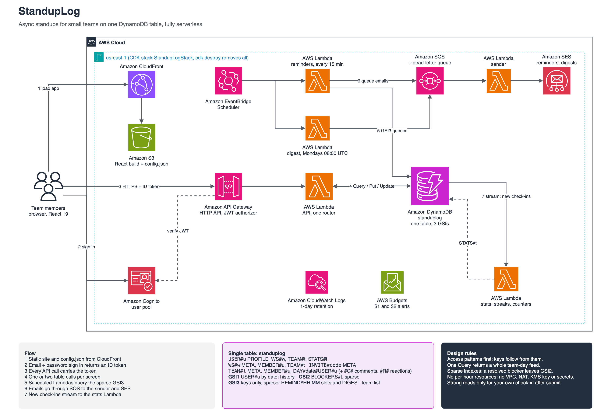

# StandupLog

Async standups for small teams, on one DynamoDB table and nothing that bills by the hour.

People post a short daily check-in per team, read the team feed, comment, react and flag blockers. Reminders arrive by email at each person's local time, and a weekly digest sums up the team. Every screen is one or two queries on a single table.

It is also a cost experiment: what does a read-heavy serverless workload of about 13M reads and 2M writes a month actually cost, and where does the money go?

> **Design the access patterns first. The keys follow from them, and the bill follows from the keys.**



## Results

One hour of simulated traffic (300 users, 40 teams, 7,915 API requests at 2.2 requests/s), measured in CloudWatch and projected to 30 days.

| | This run | Target (13M reads, 2M writes a month) |
| --- | --- | --- |
| Read units | 5.95 RRU/s | 5.02 RRU/s |
| Write units | 0.70 WRU/s | 0.77 WRU/s |
| Throttled requests | 0 | 0 |
| p50 / p95 latency (client in Asia, API in us-east-1) | 303 / 709 ms | |

Projected monthly cost at that rate (us-east-1 list prices, free tier ignored):

| Service | Projected month | Cost |
| --- | --- | --- |
| DynamoDB reads | 15.4M RRU | $1.93 |
| DynamoDB writes | 1.8M WRU | $1.13 |
| API Gateway (HTTP API) | 5.7M requests | $5.66 |
| Lambda (arm64, 256 MB) | 5.9M invocations, 66K GB-s | $2.06 |
| CloudWatch Logs | 2.0 GB ingested | $1.01 |
| **Total** | | **$11.79** |

What the numbers say:

- **DynamoDB is the cheap part.** $3.05 a month for the table and its indexes. At about 6 operations per second a small managed Postgres (roughly $12-15 a month) would also cope; DynamoDB wins on zero operations work and no idle cost, not on price.
- **Per-request services cost more than the table.** API Gateway alone is almost twice DynamoDB. Each request costs about 2.7 RRU and 0.3 WRU, but $1 per million requests at the front door.
- **Logs are a real line even with quiet code.** The app logs nothing per request; the 2 GB is almost all Lambda's own START/END/REPORT lines. Raising the Lambda system log level to WARN should remove most of it (not tried here). Retention is 1 day, so storage is negligible.
- **Index write amplification is visible but small.** 24% of write units went to GSIs (GSI1 for history, GSI2 for open blockers). Every index that projects an item adds a write; with three small indexes a check-in costs 2 WRU, or 3 with a blocker.
- **Reads are the feed.** 98% of read units hit the base table, mostly the team feed: one Query returns a day's check-ins with their comments and reactions.

Metered usage for the whole project (development, tests, seeding and the load run) comes to a few cents at list prices; the $1 and $2 budgets are there to catch anything else.

## How it works

- **API path.** The browser signs in with Cognito and calls the HTTP API; one Lambda with a small router serves every route and reads and writes the table directly.
- **Reminders.** Every 15 minutes the scheduler Lambda reads the members whose reminder slot (stored in UTC) is now, skips non-workdays and people who already checked in, and queues emails. A sender Lambda delivers them through SES, so a slow SES call never blocks the scheduler.
- **Streaks.** A DynamoDB Stream with an event filter invokes the stats Lambda only for new check-ins. It keeps a total, current and longest streak per user per team.
- **Weekly digest.** Monday 08:00 UTC, each team member gets a summary of the past week: check-ins per person, streaks, blockers raised, resolved and still open.

## Single-table design

Every screen is one query, except "missing today" (two).

| # | Access pattern | Served by |
| --- | --- | --- |
| AP1 | User profile, workspaces and teams | Query `USER#u` |
| AP2 | Workspace, members and teams | Query `WS#w` |
| AP3 | Join by invite code | Get `INVITE#code` |
| AP4 | Team config and members | Query `TEAM#t`, SK >= `MEMBER#` (skips the feed items) |
| AP5 | Team feed for a day, with comments and reactions | Query `TEAM#t`, SK begins_with `DAY#date#` |
| AP6 | Submit or edit a check-in | Put / Update `TEAM#t` `DAY#date#USER#u` |
| AP7 | Comment or react | Put under the same day prefix |
| AP8 | My history across teams | GSI1 `USER#u`, newest first |
| AP9 | Open blockers for a team | GSI2 (sparse) `BLOCKERS#t` |
| AP10 | Who has not posted today | AP4 members minus AP5 authors |
| AP11 | Reminders due in this 15-minute slot | GSI3 (sparse, keys only) `REMIND#HH:MM` |
| AP12 | Streaks and counters | Stream handler writes `USER#u` `STATS#t` |

| Entity | PK | SK | GSI |
| --- | --- | --- | --- |
| Profile | `USER#u` | `PROFILE` | |
| My workspace / my team | `USER#u` | `WS#w` / `TEAM#t` | |
| Stats | `USER#u` | `STATS#t` | |
| Workspace | `WS#w` | `META` | |
| Workspace member / team summary | `WS#w` | `MEMBER#u` / `TEAM#t` | |
| Invite | `INVITE#code` | `META` | |
| Team | `TEAM#t` | `META` | GSI3 `DIGEST` |
| Team member | `TEAM#t` | `MEMBER#u` | GSI3 `REMIND#HH:MM` |
| Check-in | `TEAM#t` | `DAY#date#USER#u` | GSI1 `USER#u`; GSI2 `BLOCKERS#t` while unresolved |
| Comment | `TEAM#t` | `DAY#date#USER#u#C#ts` | |
| Reaction | `TEAM#t` | `DAY#date#USER#u#R#emoji#by` | |

Design rules:

- **Sparse indexes.** GSI2 and GSI3 attributes exist only on items that need them. Resolving or clearing a blocker removes the attribute and the item leaves the index.
- **Index overloading.** GSI3 serves two patterns: reminder slots on member items and a `DIGEST` entry on team items, so the digest lists teams without a scan.
- **Small projections.** GSI1 and GSI2 project only the feed fields; GSI3 is keys only.
- **Copies over joins.** Names and timezones are copied onto membership items, so feeds and the reminder index need no second read. A profile change rewrites the copies.
- **Uniqueness by condition.** One check-in per user per team per day (`attribute_not_exists`), one active membership, one stats update per date.
- **Consistency.** Eventually consistent reads everywhere, except reading your own check-in right after you submit it.

## Features

- Sign up and sign in (Cognito, email and password), profile with timezone
- Workspaces with invite codes, owner and member roles
- Teams; a person can be in several
- Per-team standup config: 3 questions, workdays, reminder time
- One check-in per day per team in your own timezone, editable the same day, with an optional blocker
- Team feed by day with comments and reactions; who has not posted yet
- Open blockers, resolved by a teammate or the workspace owner
- Personal history across teams
- Email reminders at each member's local reminder time; weekly team digest
- Streaks and check-in counts

## Stack

| Folder | What |
| --- | --- |
| `infra/` | AWS CDK (TypeScript): table, Cognito, HTTP API, Lambdas, SQS, EventBridge Scheduler, S3 + CloudFront, log retention, budgets |
| `backend/` | Lambda handlers in TypeScript on Node 22 (arm64), AWS SDK v3, bundled by CDK with esbuild |
| `client/` | React 19 + Vite, talks to Cognito directly (no Amplify) |
| `load/` | Seeder, workday simulator, cleanup and CloudWatch cost report |

## Quick start

Needs Node 22+, an AWS profile with admin rights, CDK bootstrapped in us-east-1, and an SES-verified domain or address to send from.

```bash
npm run install:all
cp infra/.env.example infra/.env     # ALERT_EMAIL for budgets, SENDER_EMAIL on your SES identity
npm run infra:deploy                 # builds the client, deploys, writes infra/cdk-outputs.json
npm run infra:activate-cost-tag      # lets the budgets count only this project (billing sees the tag within 24 h)
```

The deploy prints `SiteUrl`. For local client work, `npm run client:config && npm run client:dev` serves on http://localhost:5173 against the deployed API.

## Tests

```bash
npm run infra:test      # 24 checks on the synthesized template
npm run backend:test    # unit rules plus live suites against the deployed stack
npm --prefix load test  # workday plan
```

211 checks in 10 suites. The infra suite asserts the cost guardrails (on-demand billing, no KMS key or secret, 1-day log retention, everything deletes). Backend unit suites cover the router, timezone and reminder-slot math, streaks and the digest. The live suites create their own Cognito users and data, run against the real API, and delete everything afterwards; reminder and digest tests send through the SES mailbox simulator.

## Load test and cost report

```bash
npm run load:seed                                 # 300 users, 20 workspaces, 40 teams, through the API
npm run load:simulate -- --rps 2.2 --minutes 60   # replays read-heavy workdays
npm --prefix load run costs -- --from <start> --to <end>
npm run load:cleanup                              # deletes every sim user and partition
```

Sim users have SES mailbox-simulator addresses, so reminders and digests never reach a real inbox. A simulated workday per user averages 6 feed reads, 3 home loads, 2 team views, one check-in, 0.8 comments and 1.5 reactions.

## API

All routes except `/health` need a Cognito ID token.

| Method | Path | Does |
| --- | --- | --- |
| GET | /health | Table status and indexes |
| GET / PUT | /me | Profile, workspaces and teams / save name and timezone |
| GET | /me/checkins | History, paged with `cursor` |
| POST | /workspaces | Create a workspace |
| GET | /workspaces/:workspaceId | Workspace, members, teams |
| POST | /invites/:code/join | Join by invite code |
| POST | /workspaces/:workspaceId/teams | Create a team (owner) |
| GET | /teams/:teamId | Config, members with streaks |
| PUT | /teams/:teamId/config | Questions, workdays, reminder time (owner) |
| POST | /teams/:teamId/join | Join a team |
| DELETE | /teams/:teamId/members/:userId | Leave, or remove a member (owner) |
| POST | /teams/:teamId/checkins | Today's check-in |
| GET / PUT | /teams/:teamId/checkins/today | Read (strongly consistent) / edit today's check-in |
| GET | /teams/:teamId/feed?date= | Check-ins, comments, reactions, who is missing |
| POST | /teams/:teamId/checkins/:date/:userId/comments | Comment |
| PUT / DELETE | /teams/:teamId/checkins/:date/:userId/reactions/:emoji | React / remove reaction |
| GET | /teams/:teamId/blockers | Open blockers |
| POST | /teams/:teamId/blockers/:date/:userId/resolve | Resolve a blocker |

## Cost guardrails

- On-demand table with the AWS-owned key; no customer-managed KMS key, no Secrets Manager, no VPC or NAT, nothing billed per hour.
- Explicit log groups with 1-day retention; no request or response bodies in logs; no custom metrics.
- Event filter on the stream, so comments, reactions and edits never invoke the stats Lambda.
- Budgets at $1 and $2 that count only resources tagged `project=standuplog`.
- Every resource deletes with the stack.

## Known limits

- Reminder slots use the member's UTC offset when they were last computed. After a daylight saving change the next reminder arrives an hour early or late, once, and the slot is corrected.
- A profile change rewrites name and timezone copies one item at a time. If it fails part way, saving the profile again repairs it.
- Streaks count check-ins in date order; a late backfill of an older date does not change them.
- Stream events from the first minute after the stream is created can be missed (starting position LATEST).
- The digest runs at one fixed time (Monday 08:00 UTC) for every team.
- No reminder opt-out and no SES bounce or complaint handling; this is a learning build.

## Build log

| Phase | What |
| --- | --- |
| 1 | CDK stack: table and 3 GSIs, Cognito, HTTP API, client on S3 + CloudFront, log retention, budgets |
| 2 | Sign in, profiles, workspaces, invites, teams, standup config (AP1-AP4) |
| 3 | Check-ins, feed, comments and reactions, history, blockers, missing today (AP5-AP10) |
| 4 | Email reminders: Scheduler, GSI3 slots, SQS, SES (AP11) |
| 5 | Streams for streaks and counters (AP12), weekly digest |
| 6 | Load seeder and workday simulator |
| 7 | One-hour run, CloudWatch measurement and monthly projection |

## Tear down

```bash
npm run load:cleanup    # if you seeded
npm run infra:destroy   # deletes the table, user pool, API, Lambdas, queues, schedules, site and budgets
```
